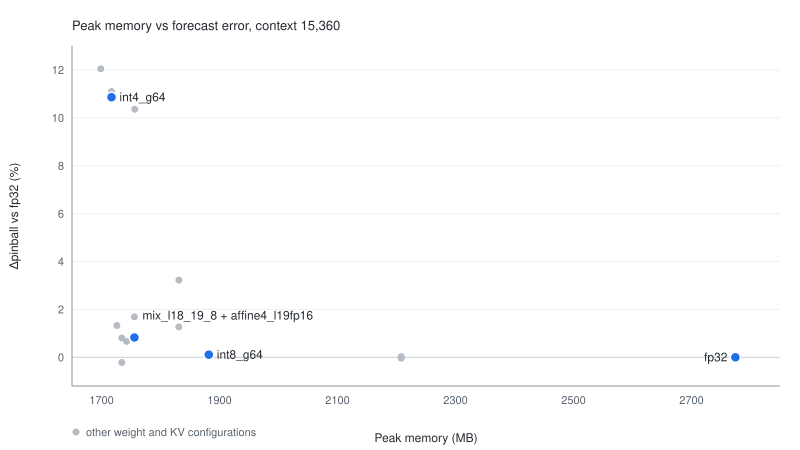

# TimesFM-MLX Quantization and Long-Context KV Lab

[](https://github.com/lingengyuan/tfm-quant-mlx/actions/workflows/tests.yml)

[中文](README.md)

Weight precision, low-bit quantization, and long-context K/V working-set compression for TimesFM 3.0 (331M) on Apple MLX. Every run reports point error, nine quantiles, peak memory, and throughput on the same windows.

- Model: `google/timesfm-3.0-pytorch`, 20 layers, 1280 dims, 16 heads, context up to 15,360, horizon 64.
- Environment: Apple M5 / 32 GB / macOS 27.0.1, MLX 0.32.4, timesfm 3.0.2, Python 3.12.14.



Peak memory against the pinball change from fp32 at context 15,360. Blue points are the four configurations the findings call out; grey points are other weight and KV setups. The figure is rendered from the JSON under `results/` by `scripts/tradeoff.py`.

## Findings

- `fp16` / `bf16`: weights 1323 → 661 MB (2.00×), pinball change ≤0.05%; `int8_g64` 375 MB (3.53×), +0.11%.
- Plain `int4`: 191–251 MB (5.3–6.9×), pinball +10–12%, quantile crossing 9–19%. Loss concentrates in the last layer (+7.9% alone) and the output head (+67.8% at 4-bit).
- For 4-bit size, use `mix_l18_19_8` (227 MB, 5.82×, +0.80%). Clipping at 0.95, `mix_l18_19_8c95`, reaches −0.22% / +0.61% on ETT and Jena but is worse on traffic (+2.00%), so it is not a general default.
- KV: `affine8` 1.78× (−0.01%), `affine4` 3.20× (+0.52%), `turbo3_mse` 3.10× (+2.71%). `qjl1` also reaches 1.78×, but compresses only K and leaves V at fp16, so it is the worst option at that ratio (+4.73%).
- KV last block: keeping layer 19 at fp16 moves `affine4` from +0.52% to **−0.36%** (137 MB, 2.88×) and `turbo3_mse` from +2.71% to +0.69% (141 MB, 2.80×). A four-domain check (ETTh1, ETTh2, Jena, Electricity) on an independent window block puts every paired 95% CI below zero, so the strategy is a general recommendation; the recovery follows `affine4`'s own error (0.74–3.03%). The full-grid intervals against fp32 still include zero (`affine4` [−0.33%, +1.65%], last-block fp16 [−1.12%, +0.57%]), so the recovery does not reach fp32. Head-wise error is spread out, with no dominant head.
- Combination: `mix_l18_19_8 + affine4_l19fp16` gives +0.82% pinball, 227 MB of weights, 137 MB of KV, and 1755 MB peak (fp32: 2774 MB).
- Multivariate (7 ETT channels per decode): fp32 pinball 0.1152, better than 0.1168 univariate; KV loss grows about 6×, mostly from variate attention. Sequence `affine4` plus variate `affine8` gives +1.15% (2418 MB, 2.29×).
- Covariates: dropping them costs +4.98% pinball. With covariates, int8 is +0.35%, int4 +17.2%, mix −0.87%; KV `affine4` is +3.55%, and the seq/var mix is −0.91%.
- Cross-domain (ETTh1 + Jena + Electricity): int8 +0.17%, int4 +22.7% (Jena +47.9%), mix +1.37%, `mix_l18_19_8c95` +0.11% (Jena +0.61%); KV `affine4` +2.21%, last-block fp16 +0.90%.
- Longer horizons (64 → 1024): int4's relative loss falls from +10.1% to +3.0%, mix from +1.6% to −0.8%; absolute pinball goes 0.168 → 0.284. Stitching does not amplify relative quantization error.
- Quantization does not speed anything up: the model GEMM is only 482 tokens, and the three precisions differ by ≤8%; end-to-end quantized runs move −0.4% to −5.6%, with no stable gain. The benefit of 4-bit is memory (2774 → 1717 MB), not throughput.
- Cross-backend baseline: MLX fp32 against the PyTorch backend on 56 series from the four ETT tables, mean normalized deviation 0.0013, max 0.0081, pinball difference −0.001% (context 15,360).

Choice: `int8_g64` or `mix_l18_19_8` for weights; for univariate KV, layer-19 `affine4` with the last block at fp16 (confirmed on four domains, limited to univariate, fp32 weights, and context 15,360); for multivariate KV, sequence `affine4` plus variate `affine8`.

## Results

### Cross-backend baseline: MLX vs PyTorch (context 15,360)

56 series (four ETT tables, two windows each), torch 2.15.0 on CPU, compared with MLX fp32 quantile by quantile.

| Metric | Value |
|---|---|
| Max normalized deviation | 0.0081 |
| Mean normalized deviation | 0.0013 |
| 95th percentile normalized deviation | 0.0034 |
| Pinball difference (MLX − torch) | −0.001% |
| Correlation | 0.9999998 |

The MLX fp32 baseline matches the original implementation, so the `Δ` in the other tables has a trustworthy reference. Full results in [`results/parity.json`](results/parity.json).

### Weights and mixed precision (context 15,360)

| config | weights MB | ratio | bits/w | nMAE | ΔnMAE | pinball | Δpinball | cov err | cross % | series/s | peak MB |
|---|---|---|---|---|---|---|---|---|---|---|---|
| fp32 | 1323 | 1.00× | 32.00 | 0.3192 | — | 0.1258 | — | 0.0400 | 0.47 | 13 | 2774 |
| fp16 | 661 | 2.00× | 16.00 | 0.3192 | −0.01% | 0.1257 | −0.04% | 0.0415 | 0.51 | 13 | 2208 |
| bf16 | 661 | 2.00× | 16.00 | 0.3193 | +0.01% | 0.1258 | +0.03% | 0.0493 | 0.64 | 13 | 2208 |
| int8_g64 | 375 | 3.53× | 9.00 | 0.3194 | +0.07% | 0.1259 | +0.11% | 0.0459 | 0.72 | 13 | 1882 |
| int4_g64 | 210 | 6.31× | 5.00 | 0.3511 | +10.20% | 0.1385 | +10.86% | 0.0603 | 18.51 | 13 | 1717 |
| int4c95_g64 | 210 | 6.31× | 5.00 | 0.3483 | +9.74% | 0.1382 | +11.10% | 0.0618 | 16.74 | 9 | 1717 |
| int4_g32 | 251 | 5.27× | 6.00 | 0.3499 | +9.83% | 0.1380 | +10.36% | 0.0614 | 16.45 | 13 | 1756 |
| int4_g128 | 191 | 6.93× | 4.50 | 0.3549 | +11.78% | 0.1397 | +12.05% | 0.0687 | 12.12 | 13 | 1699 |
| mix_l19_8 | 219 | 6.04× | mix | 0.3234 | +1.14% | 0.1277 | +1.33% | 0.0560 | 0.73 | 9 | 1726 |
| mix_l18_19_8 | 227 | 5.82× | mix | 0.3225 | +0.84% | 0.1270 | +0.80% | 0.0544 | 0.70 | 9 | 1734 |
| mix_l18_19_8c95 | 227 | 5.82× | mix | 0.3183 | −0.14% | 0.1252 | −0.22% | 0.0546 | 0.73 | 9 | 1734 |
| mix_top3_8 | 235 | 5.62× | mix | 0.3222 | +0.74% | 0.1269 | +0.66% | 0.0532 | 0.68 | 9 | 1743 |

`int4_g128` skips residual blocks whose input dimension is 192; those stay fp32. The mixed configurations quantize the remaining layers at 4-bit; `mix_l19_8` keeps layer 19 and the input residual block at 8-bit, `mix_l18_19_8` also keeps layer 18, and `mix_top3_8` also keeps layer 3. The output head always stays fp32.

### int4 clipping (context 15,360)

Clipping trims each input group to 95% of its largest absolute value before quantization (`int4c95_g64`, `mix_l18_19_8c95`). Outliers shrink, so the step size shrinks too.

| Config | ETT + synthetic | Cross-domain | Jena |
|---|---|---|---|
| int4_g64 | +10.86% | +22.70% | +47.88% |
| int4c95_g64 | +11.10% | +18.96% | +34.28% |
| mix_l18_19_8 | +0.80% | +1.37% | +3.62% |
| mix_l18_19_8c95 | −0.22% | +0.11% | +0.61% |

- Clipping works on mixed precision for ETT and Jena: ETT goes from +0.80% to −0.22%, cross-domain from +1.37% to +0.11%.
- For plain int4 it only helps on Jena; ETT is flat (+10.86% → +11.10%) and Electricity gets worse (+9.14% → +13.21%).
- It is not a general default: on traffic, `mix_l18_19_8` goes +1.43% → +2.00% and int4 +32.9% → +42.4% (15,360); on exchange, int4 improves from +10.9% to +5.1% (2,048).

The default stays `mix_l18_19_8`; `mix_l18_19_8c95` suits ETT- and Jena-like data.

Full table in [`results/clip_report.md`](results/clip_report.md).

### Why quantization does not speed up (context 15,360)

MLX `nn.quantize` replaces Linear with `nn.QuantizedLinear`, and the matrix multiply goes through `mx.quantized_matmul`; this is not a missing kernel. The problem is the shape: 482 tokens per series, so a batch of 8 runs a 3,856-row GEMM; 15,424 rows is the long-context stress case.

| tokens | fp32 ms | int8 ms | int4 ms |
|---|---|---|---|
| 482 (per series) | 1.03 | 0.95 | 0.97 |
| 3,856 (batch 8, actual) | 2.84 | 2.84 | 2.67 |
| 15,424 (stress) | 6.03 | 5.85 | 5.73 |

End to end (batch 8):

| Mode | ms | series/s | peak MB |
|---|---|---|---|
| fp32 | 699.8 | 11.4 | 2774 |
| int8_g64 | 675.4 | 11.8 | 1882 |
| int4_g64 | 660.8 | 12.1 | 1717 |
| fp16 | 697.3 | 11.5 | 2208 |
| sdpa (no KV compression) | 666.7 | 12.0 | 2702 |
| affine4 | 766.1 | 10.4 | 2846 |
| affine4 + sdpa | 627.3 | 12.8 | 2778 |

- At 482 and 15,424 tokens the quantized GEMM is 5–8% faster than fp32; at 3,856 the medians are close, and fp32 has a 1.4 ms interquartile range, so the difference is not significant.
- End-to-end, quantized configurations move −0.4% to −5.6%; repeat runs vary by about 10%, so this is not a stable speedup.
- The fused attention path is 4.7% faster without KV and 18.1% faster under `affine4` (766.1 → 627.3 ms); this is a paired result within one run.
- KV `affine4` is 9.5% slower than fp32 (766.1 vs 699.8 ms); with fused attention it is 627.3 ms.
- KV speedup needs a custom kernel that fuses decompression and attention; this repository does not have one.
- `tfmq profile` reproduces the tables and writes [`results/profile.json`](results/profile.json), which also records the raw timings, git commit and dirty state, checkpoint hash, synthetic input hash, and environment.

### SDPA backend (ETTh1, context 2,048 / 15,360)

The same configuration run with the hand-written attention path and with `mx.fast.scaled_dot_product_attention`.

| Config | Context | manual pinball | sdpa pinball | Δpinball | ΔnMAE |
|---|---|---|---|---|---|
| fp32 | 2048 | 0.1492 | 0.1492 | −0.01% | −0.01% |
| fp32 | 15360 | 0.1373 | 0.1373 | −0.00% | −0.00% |
| mix_l18_19_8 | 2048 | 0.1531 | 0.1530 | −0.02% | −0.01% |
| mix_l18_19_8 | 15360 | 0.1384 | 0.1384 | −0.00% | −0.00% |
| affine4 | 15360 | 0.1374 | 0.1380 | +0.47% | +0.65% |
| affine4_l19fp16 | 15360 | 0.1364 | 0.1374 | +0.76% | +0.52% |

- Without KV compression the two paths differ by ≤0.02%, so SDPA is a drop-in speed option.
- With KV compression the difference rises to +0.47% / +0.76%, so SDPA is not a numerically equivalent swap. Treating both at once needs its own evaluation.
- Full table in [`results/attention.md`](results/attention.md).

### Layer-wise 4-bit sensitivity (context 2,048)

| Component | bits | Δpinball | cross % |
|---|---|---|---|
| 18 of the 20 layers, quantized one at a time | 4 | −0.20% ~ +0.49% | 0.00 |
| layer 19 | 4 | +7.91% | 16.27 |
| input residual block | 4 | +2.55% | 0.00 |
| all attention (20 layers) | 4 | +4.96% | 2.86 |
| all FFN (20 layers) | 4 | +6.72% | 14.41 |
| output head | 8 | +0.95% | 8.68 |
| output head | 4 | +67.78% | 36.30 |

Full layer table in [`results/sensitivity.md`](results/sensitivity.md); mixed-precision results in [`results/mixed_report.md`](results/mixed_report.md).

Holdout check (ETTh2, context 2,048, not used for the ETT selection): layer 19 at 4-bit is +2.33%, still the largest single layer; the input residual block is +2.60%; the 4-bit output head is +31.75%. Same direction as ETT, smaller magnitude.

### KV compression (context 15,360, batch 8)

| KV mode | K bits | V bits | KV MB | reduction | nMAE | ΔnMAE | Δpinball | point dev | mean dev | cov err | series/s | peak MB |
|---|---|---|---|---|---|---|---|---|---|---|---|---|
| affine8 | 9.00 | 9.00 | 222 | 1.78× | 0.3193 | +0.01% | −0.01% | 0.0022 | 0.0024 | 0.0401 | 12 | 2856 |
| affine4 | 5.00 | 5.00 | 123 | 3.20× | 0.3202 | +0.62% | +0.52% | 0.0382 | 0.0405 | 0.0431 | 11 | 2847 |
| affine4_l19fp16 | 5.55 | 5.55 | 137 | 2.88× | 0.3177 | −0.28% | −0.36% | 0.0236 | 0.0256 | 0.0421 | 11 | 2847 |
| turbo3_mse | 5.16 | 5.16 | 127 | 3.10× | 0.3257 | +2.32% | +2.71% | 0.0607 | 0.0668 | 0.0404 | 6 | 2922 |
| turbo3_l19fp16 | 5.70 | 5.70 | 141 | 2.80× | 0.3198 | +0.43% | +0.69% | 0.0382 | 0.0433 | 0.0408 | 6 | 2922 |
| turbo3_prod | 5.58 | 5.58 | 138 | 2.87× | 0.3304 | +4.52% | +5.04% | 0.1004 | 0.1088 | 0.0464 | 6 | 2804 |
| turbo2_mse | 3.58 | 3.58 | 88 | 4.48× | 0.3524 | +11.51% | +11.86% | 0.1443 | 0.1560 | 0.0453 | 7 | 2858 |
| qjl1 | 2.00 | 16.00 | 222 | 1.78× | 0.3328 | +4.84% | +4.73% | 0.1095 | 0.1133 | 0.0382 | 11 | 2969 |

`_l19fp16` keeps only layer 19 at fp16 and compresses the other 19 layers as usual, costing 14 MB more logical KV. Peak memory does not change: compressed K/V is decoded back to fp32 before attention.

Paired bootstrap (15,360): the 95% CI for `affine4` and for last-block fp16 both include zero; `int4`, `turbo3_mse`, and `qjl1` exclude zero. Full intervals in the paired-difference section of [`results/report.md`](results/report.md).

Full tables, four contexts (512 / 2048 / 8192 / 15360), and per-decile offsets are in [`results/report.md`](results/report.md).

### KV layers and heads (context 15,360)

60 windows (ETTh1 + synthetic), sequence attention only. The numbers differ from the full grid because the datasets and window counts differ.

| Config | affine4 Δpinball | turbo3_mse Δpinball | Logical KV MB (affine4 / turbo3) |
|---|---|---|---|
| All layers compressed | +0.652% | +2.261% | 123 / 127 |
| Layer 19 only | +0.778% | +1.534% | — |
| All but layer 19 | −0.301% | +0.303% | 137 / 141 |
| Worst single head | +0.240% (head15) | +0.490% (head08) | — |
| 16 heads together | +1.595% | +2.285% | — |

- Under both modes layer 19 is the main source: compressing it alone comes close to or exceeds the full error.
- Under `affine4` the per-layer errors do not add up: the single-layer sum is +1.39%, above the full +0.65%; only keeping layer 19 recovers reliably (+0.95 pp).
- Head-wise error is spread out; the 16-head sum is on the order of the full error or higher, with no dominant head. Head-wise mixed precision pays less than layer-wise.

Holdout: the strategy was chosen on ETTh1 + synthetic and checked on ETTh2, which took no part in the selection (`affine4`, 3 windows).

| Metric | ETTh1 + synthetic | ETTh2 (holdout) |
|---|---|---|
| All layers compressed Δpinball | +0.652% | +0.980% |
| Layer 19 only | +0.778% | +0.354% |
| All but layer 19 | −0.301% | +0.531% |
| Recovery from keeping layer 19 | +0.95 pp | +0.45 pp |
| Largest single-layer error | layer 19, +0.778% | layer 17, +0.423% |
| Largest recovery from one layer | — | layer 01, +1.282 pp |

Layer 19 is still the second-largest single-layer error on ETTh2 (+0.354%), but keeping it recovers only 0.45 pp; the largest recovery comes from layer 01. The last-block fp16 strategy did not reproduce on ETTh2, so layer-wise mixed precision needs checking per dataset.

Full tables: [`results/kv_sensitivity.md`](results/kv_sensitivity.md), [`results/kv_sensitivity_turbo3.md`](results/kv_sensitivity_turbo3.md), [`results/kv_sensitivity_holdout.md`](results/kv_sensitivity_holdout.md).

### Last-block KV strategy across four domains (context 15,360)

Three fixed runs: fp32, `affine4`, and `affine4` with layer 19 at fp16. Windows are the block before each series' most recent ones (`window_mode: tail`, `offset: 6`, six origins per domain); those origins are not among the six the full grid uses. At 15,360 the input range still overlaps the grid, so independence covers the forecast origins only. ETTh2, Jena, and Electricity took no part in choosing the strategy.

| Dataset | fp32 | affine4 | Layer 19 at fp16 | Paired change vs affine4 | 95% CI |
|---|---|---|---|---|---|
| ETTh1 | 0.1454 | 0.1484 | 0.1471 | −0.84% | [−1.16%, −0.55%] |
| ETTh2 | 0.0704 | 0.0713 | 0.0702 | −1.54% | [−1.91%, −1.07%] |
| Jena | 0.0464 | 0.0483 | 0.0469 | −3.03% | [−5.81%, −1.59%] |
| Electricity | 0.1979 | 0.1989 | 0.1974 | −0.74% | [−1.69%, −0.34%] |

- Every domain's CI upper bound is below zero, so the preset rule returns a general recommendation.
- The recovery follows `affine4`'s own error: Jena has the largest error (+4.18%) and the largest recovery (3.03%); Electricity has the smallest (+0.47%) and recovers 0.74%.
- ETTh2's 0.0702 sits just below fp32's 0.0704; that is noise and does not mean it beats fp32.
- The earlier ETTh2 holdout (3 spread windows) recovered 0.45 pp (+0.98% → +0.53%); this block recovers 1.56 pp (+1.32% → −0.24%). Same direction, magnitude varies by block, so report intervals rather than a single point.
- Scope: univariate, fp32 weights, `affine4`, context 15,360. Multivariate and mixed-precision weights were not rechecked in this round.

Full table: [`results/kv_lastlayer_compare.md`](results/kv_lastlayer_compare.md); raw results [`results/kv_lastlayer.json`](results/kv_lastlayer.json).

### Weight + KV combinations (context 15,360)

Only one weight configuration, `mix_l18_19_8`, combined with four KV modes. For fp32 + KV, see the KV table above.

| KV | weights MB | KV MB | Δpinball | ΔnMAE | peak MB |
|---|---|---|---|---|---|
| none | 227 | 395 | +0.80% | +0.84% | 1734 |
| affine4 | 227 | 123 | +1.69% | +1.79% | 1756 |
| affine4_l19fp16 | 227 | 137 | +0.82% | +1.00% | 1756 |
| turbo3_mse | 227 | 127 | +3.22% | +3.05% | 1831 |
| turbo3_l19fp16 | 227 | 141 | +1.27% | +1.18% | 1831 |

- Errors add up roughly but not exactly: mix +0.80% and affine4 +0.52% would give +1.32% linearly; the measured value is +1.69%.
- Both turbo combinations land below the linear sum: `turbo3_mse` 3.51% → 3.22%, `turbo3_l19fp16` 1.49% → 1.27%.
- Peak memory is dominated by the weights (2846 → 1755 MB); KV compression alone does not lower the peak.

Full table in [`results/combo_report.md`](results/combo_report.md).

### Multivariate input (context 15,360)

All seven channels of an ETT table enter one decode as seven variates; the control decodes the same windows channel by channel. Both cover the four ETT tables, four windows per series, 112 series in total.

| Config | Univariate Δpinball | Multivariate Δpinball |
|---|---|---|
| fp32 pinball | 0.1168 | 0.1152 |
| int8_g64 | +0.16% | +0.21% |
| int4_g64 | +12.37% | +12.91% |
| mix_l18_19_8 | +0.97% | +1.55% |
| KV affine4 | +0.91% | +5.51% |
| KV affine4_l19fp16 | +0.06% | +0.53% |
| KV turbo3_mse | +1.68% | +11.16% |

- Multivariate point forecasts are slightly better (pinball 0.1152 vs 0.1168), while coverage error gets worse (0.069 vs 0.063).
- Weight quantization behaves about the same in both modes, within 0.6 pp.
- KV loss comes mainly from variate attention: compressing sequence only gives +0.92% / +1.49% (affine4 / turbo3), variate only gives +3.38% / +6.92%.
- The multivariate probe carries seven variates and counts both attention types, so logical bytes are about 14× the univariate table (1727 MB for affine4). Compare the reduction, not the absolute size.

Assigning precision by scope:

| KV strategy | KV MB | reduction | Δpinball | point dev |
|---|---|---|---|---|
| affine4, both scopes | 1727 | 3.20× | +5.51% | 0.0680 |
| seq affine4 + var affine8 | 2418 | 2.29× | +1.15% | 0.0353 |
| seq affine4 + var fp16 | 3628 | 1.52× | +0.92% | 0.0351 |
| turbo3, both scopes | 1784 | 3.10× | +11.16% | 0.1112 |

Moving the variate scope from affine8 to fp16 recovers only 0.23 pp more while KV grows from 2418 to 3628 MB, so it does not pay.

Full tables: [`results/multi_report.md`](results/multi_report.md), [`results/uni_control_report.md`](results/uni_control_report.md), [`results/multi_scope_report.md`](results/multi_scope_report.md), [`results/multi_kv_mixed_report.md`](results/multi_kv_mixed_report.md).

### Covariate input (context 15,360)

The target is the last channel of each ETT table; the other six channels are past-only covariates, and two sin/cos calendar features are past-future covariates. Four ETT tables, six windows each, 24 target series in total.

| Config | pinball | Δpinball | ΔnMAE | cross % | KV MB | reduction |
|---|---|---|---|---|---|---|
| fp32 without covariates | 0.0969 | +4.982% | +5.917% | 0.07% | — | — |
| fp32 | 0.0923 | — | — | 0.08% | — | — |
| int8_g64 | 0.0926 | +0.349% | +0.228% | 0.17% | — | — |
| int4_g64 | 0.1081 | +17.150% | +13.254% | 21.92% | — | — |
| mix_l18_19_8 | 0.0915 | −0.872% | −1.708% | 0.21% | — | — |
| affine4 | 0.0956 | +3.550% | +3.652% | 5.69% | 2221 | 3.20× |
| affine4_seq_var8 | 0.0914 | −0.914% | −1.453% | 0.11% | 3109 | 2.29× |
| affine4_l19fp16 | 0.0906 | −1.794% | −3.008% | 0.07% | 2465 | 2.88× |

- The covariates are the main gain: removing them costs +4.98% pinball.
- int4 loses more under covariates (+17.15%); `mix_l18_19_8` is −0.87%.
- With nine variates, KV `affine4` is +3.55%; the seq/var mix and last-block fp16 come back to −0.91% and −1.79%.
- With 24 target series, negative values under 2% should not be extrapolated.

Full table in [`results/covariates.md`](results/covariates.md).

### Cross-domain validation (context 15,360)

ETTh1 plus Jena Climate (10 min) and UCI Electricity (15 min), first eight channels of each table, four windows per series.

| Config | ETTh1 | Jena | Electricity | Aggregate |
|---|---|---|---|---|
| int8_g64 | −0.07% | +0.44% | +0.15% | +0.17% |
| int4_g64 | +11.08% | +47.88% | +9.14% | +22.70% |
| int4c95_g64 | +9.38% | +34.28% | +13.21% | +18.96% |
| mix_l18_19_8 | +0.77% | +3.62% | −0.28% | +1.37% |
| mix_l18_19_8c95 | +0.45% | +0.61% | −0.73% | +0.11% |
| KV affine4 | +0.05% | +4.81% | +1.76% | +2.21% |
| KV affine4_l19fp16 | −0.67% | +3.44% | −0.06% | +0.90% |

- int8 holds up across domains, with loss ≤0.5 pp.
- int4 is domain-sensitive: Jena +47.9%, four times ETTh1; `mix_l18_19_8` brings Jena down to +3.6%.
- On Jena, KV `affine4` costs +4.8%; last-block fp16 cuts the aggregate from +2.21% to +0.90%.

The naive baseline (repeat the last context value) beats the fp32 point forecast on exchange: nMAE 0.2718 vs 0.3126 at context 2,048 (fp32 is 15.0% worse). Pinball goes the other way, 0.1359 vs 0.1115 (fp32 is 18.0% better). On this dataset the model's point forecast loses to the naive baseline; its quantile forecast still wins.

traffic (hourly) and exchange (daily, 7,588 rows, no 15,360 support):

| Config | traffic 2,048 | exchange 2,048 | traffic 15,360 |
|---|---|---|---|
| int8_g64 | +0.22% | −0.15% | +0.22% |
| int4_g64 | +33.03% | +10.88% | +32.87% |
| int4c95_g64 | +37.89% | +5.14% | +42.43% |
| mix_l18_19_8 | +2.65% | −4.41% | +1.43% |
| mix_l18_19_8c95 | +1.34% | −7.29% | +2.00% |
| KV affine4 | +10.47% | +2.68% | +7.05% |
| KV affine4_l19fp16 | +5.74% | +2.15% | +2.41% |

- int4 loses more on traffic than on ETT (+33%), and clipping at 0.95 makes it worse.
- On exchange, clipping improves int4 from +10.9% to +5.1%, the opposite direction from traffic.

Full tables: [`results/domains_report.md`](results/domains_report.md), [`results/domains2_report.md`](results/domains2_report.md).

### Longer horizons (context 2,048)

ETTh1, four windows per series.

| horizon | Config | Δpinball | cross % |
|---|---|---|---|
| 64 | int8_g64 | +0.052% | 0.00% |
| 64 | int4_g64 | +10.117% | 9.84% |
| 64 | mix_l18_19_8 | +1.573% | 0.00% |
| 64 | affine4 | +0.389% | 0.00% |
| 256 | int8_g64 | −0.144% | 0.00% |
| 256 | int4_g64 | +3.683% | 5.66% |
| 256 | mix_l18_19_8 | +0.561% | 0.00% |
| 256 | affine4 | +0.479% | 0.00% |
| 1024 | int8_g64 | −0.121% | 0.00% |
| 1024 | int4_g64 | +2.973% | 3.20% |
| 1024 | mix_l18_19_8 | −0.756% | 0.00% |
| 1024 | affine4 | +1.787% | 0.00% |

fp32 pinball: 0.1681 / 0.2142 / 0.2840 (h = 64 / 256 / 1024). fp32 latency at batch 8 is 77–101 ms; repeat runs vary by up to about 20%, and quantization and KV show no stable speedup.

- int4's relative loss falls as the horizon grows (+10.12% → +2.97%), because the absolute error at long horizons is larger to begin with.
- `mix_l18_19_8` and `affine4` stay within ≤1.6% / ≤1.8% at every horizon.
- Stitching does not amplify relative quantization error.

Full table in [`results/horizon.md`](results/horizon.md).

## Usage

### Installation

Requires Apple Silicon macOS, Python 3.12, and [uv](https://docs.astral.sh/uv/).

```bash
uv venv --python 3.12 .venv
uv pip install -e .
./scripts/download_checkpoint.sh models/timesfm-3.0
```

Weights use the non-commercial TimesFM license; they are not redistributed here.

### Quick start

```bash
.venv/bin/tfmq run --preset quick
```

Results go to `results/quick.json`; the run takes about 2 minutes.

### Forecast

```bash
.venv/bin/tfmq predict data.csv --context 2048 --horizon 64 \
  --weights int8_g64 --kv affine4 -o forecasts.csv
```

Each numeric column is an independent univariate series by default, using its last `context` valid values. Output columns are `series, step, point, q0.1 … q0.9`, with quantiles sorted per row. Omitting `--weights` and `--kv` uses fp32 and no compression.

- `--batch`: series per decode, default 8. Equal-length series are batched together and the output keeps the column order.
- `--attention sdpa`: the fused MLX attention path; it is not bit-identical to the manual path, and the gap is larger under KV compression.
- `--multi`: decode all numeric columns together as variates.
- `--covariates`: the last column is the target and the others are past-only; sin/cos calendar features are past-future, with `--period` defaulting to 24.
- `--target` / `--time`: name the target and timestamp columns; calendar features follow the timestamps, not the row number.
- `--future-covariates`: comma-separated known-future columns whose last `horizon` rows supply future values; the target history stops before them.
- Missing values are not dropped: target, past-only, and past-future inputs carry missing masks, so the time spacing stays intact.

### Quantized export

```bash
.venv/bin/tfmq convert --weights int8_g64 --out models/timesfm-int8
.venv/bin/tfmq predict data.csv --checkpoint models/timesfm-int8 --weights int8_g64
```

The export directory holds the packed weights, the quantization spec, and the architecture (`tfmlab-quant.json`); loading skips the 1.3 GB fp32 weights and the re-quantization. `--weights` must match the exported spec. Grids still use the fp32 checkpoint as their reference and do not read export directories.

### Configuration

See `configs/*.yaml` for an example of every field.

| Field | Purpose |
|---|---|
| `datasets` / `synthetic` | Evaluation datasets; with `synthetic` off, only real data runs |
| `max_channels` | Channels kept per dataset; 0 keeps all |
| `contexts` / `windows` | Context length; windows per series |
| `window_mode` | `spread` (default) or `tail`; `tail` takes the most recent windows, which with the probe `--offset` forms a non-overlapping block |
| `weights` | Weight configurations |
| `kv` / `kv_contexts` | KV modes; contexts at which KV is measured |
| `kv_weights` | Weight configurations paired with the KV grid |
| `kv_scopes` | `seq` / `var` / `both` |
| `attention` | `manual` (default) or `sdpa` fused attention |
| `multi` | Decode one window's channels together |
| `out` | Result JSON path |

### Full grids and probes

```bash
for cfg in full mixed combo multi uni_control multi_scope multi_kv_mixed domains domains2 kv_mixed; do
  .venv/bin/tfmq run --config configs/$cfg.yaml
done
.venv/bin/tfmq report results/full.json -o results/report.md
.venv/bin/tfmq sensitivity
.venv/bin/tfmq kv-sensitivity --kv affine4
.venv/bin/tfmq kv-sensitivity --kv turbo3_mse \
  --out results/kv_sensitivity_turbo3.json --md results/kv_sensitivity_turbo3.md
.venv/bin/tfmq kv-sensitivity --kv affine4 --offset 6  # keep the 6 most recent windows for evaluation

.venv/bin/tfmq run --config configs/attention_manual.yaml
.venv/bin/tfmq run --config configs/attention_sdpa.yaml
.venv/bin/tfmq attention-compare results/attention_manual.json results/attention_sdpa.json \
  -o results/attention.md
.venv/bin/tfmq run --config configs/kv_lastlayer.yaml
.venv/bin/tfmq compare results/kv_lastlayer.json --base affine4 \
  -o results/kv_lastlayer_compare.md
.venv/bin/tfmq profile
.venv/bin/tfmq parity  # needs torch: uv pip install -e ".[parity]"
.venv/bin/tfmq covariates
.venv/bin/tfmq horizon
```

The full grids take about 20–25 minutes on an M5 / 32 GB machine.

### Self-check

```bash
.venv/bin/python -m pytest tests -q
.venv/bin/tfmq sanity
```

## Method

### Data and metrics

- Data: ETT-small (ETTh1/ETTh2/ETTm1/ETTm2, seven channels each), Jena Climate (10 min, 14 channels), UCI Electricity (15 min, 321 channels), traffic (hourly, 862 channels), exchange (daily, 8 channels), plus eight deterministic synthetic series.
- Windows: the last `context` points of each series predict the next 64. In multivariate mode the seven channels of one timestamp decode together.
- Covariates: the last channel is the target, the others are past-only, and sin/cos calendar features are past-future.
- `nMAE` and pinball are normalized by each window's context standard deviation; `Δ` is relative to the same-window fp32 output.
- `Naive baseline`: every window repeats its last context value, with all nine quantiles at that value; reports give fp32 relative to it.
- `Paired differences`: reports resample forecast origins 2000 times, recompute both means each draw, and give a 95% CI of each configuration's pinball difference from fp32.
- `Missing values`: target and covariates reach the model as masks; rows are never dropped across columns, so the time spacing stays intact.
- `Holdout`: `--offset N` on `sensitivity` / `kv-sensitivity` uses an earlier contiguous block of windows; an evaluation config uses `window_mode: tail` with `offset` for the same kind of block.
- `cov err` is the mean gap between the nine decile coverages and their nominal values; `cross %` is the share of adjacent deciles out of order before sorting.
- `KV MB` is computed from tensor shapes and bit widths; `reduction` is relative to fp16 K/V; `peak MB` is MLX peak memory including resident weights.

### Weight quantization

- `fp32` / `fp16` / `bf16`: convert the whole module tree to the dtype.
- `int8_g64` / `int4_g64` / `int4_g32` / `int4_g128`: MLX affine quantization; the output head stays fp32, and `int4_g128` skips layers whose input dimension is not a multiple of 128.
- Mixed precision keeps the last block, the residual block, or layer 3 at 8-bit, following the layer-wise `tfmq sensitivity` results.
- Clipping: `int4c95_g64` and `mix_l18_19_8c95` trim each input group to 95% of its largest absolute value before quantization.

### KV compression

The TimesFM 3.0 MLX backend runs one full-sequence forward pass with no cross-call KV cache; here the K/V working set of each attention layer is compressed.

- `affine8` / `affine4`: MLX affine quantization with group 64 after flattening heads.
- `turbo3_mse` / `turbo2_mse` / `turbo3_prod`: PolarQuant / PolarQuant+QJL, following the MLX implementation in `lingengyuan/qjl-mlx`, with head_dim zero-padded to 128.
- `qjl1`: 1-bit sign estimate; compresses K only and leaves V at fp16.
- `K bits` / `V bits` are converted back to the original `head_dim`: PolarQuant's angle bits after zero-padding to 128, the fp32 norm per value, and prod's QJL bits and projection are all counted.
- `_l19fp16`: assigns compressors per layer, with layer 19 passing through.
- `affine4_seq_var8` / `affine4_seq_varfp16`: assigns compressors per attention type.
- `kv_weights` pairs weights with the KV grid; `kv_scopes` splits sequence and variate compression error.

Compressed K/V is decoded before attention, so the logical K/V shrinks while peak memory does not necessarily follow.

## Layout

```
src/tfmlab/
  data.py             datasets and rolling windows
  weights.py          dtype / affine / mixed-precision weight quantization
  sensitivity.py      layer-wise 4-bit sensitivity
  kv.py               affine, PolarQuant, QJL KV compressors
  kv_sensitivity.py   KV layer and head sensitivity
  profile.py          GEMM and end-to-end profile
  parity.py           PyTorch backend comparison
  covariates.py       quantization and KV under covariates
  horizon.py          quantization and KV at longer horizons
  predict.py          CSV forecasting CLI
  convert.py          quantized export and direct loading
  attention.py        attention patch
  attention_compare.py  manual vs SDPA result comparison
  compare.py          paired comparison of two runs
  runtime.py          loading, inference, timing, memory
  metrics.py          point and quantile metrics
  runner.py           grid execution
  report.py           Markdown reports
configs/              full / quick / mixed / kv_mixed / combo / multi grids
results/              JSON, reports, sensitivity tables
scripts/              checkpoint download and the trade-off figure
tests/
```

## Limitations

- One checkpoint, zero-shot, horizon 64; longer horizons use stitching with a different error structure.
- The data is mostly ETT and synthetic; it does not represent every domain.
- `fp16`/`bf16` weights upcast to fp32 in some operators (RoPE, running stats), so compute gains trail memory gains.
- KV compression has no fused kernel: decompression counts toward throughput, and lowering peak memory needs a custom Metal kernel.
- KV sensitivity covers the 60 windows of ETTh1 + synthetic. The layer-19 result holds under both compression modes; the −0.36% mix is under 1% and should not be extrapolated.
- Multivariate only covers the seven ETT channels decoded together; varying variate counts and subsets are untested.
- Covariates cover 24 target series only; past-only uses other ETT channels and past-future uses calendar features, so real exogenous variables are untested.
- Domains are capped at the first eight channels of Jena, Electricity, traffic, and exchange; exchange has no 15,360-row history; the horizon probe covers ETTh1 at context 2,048 only.
- Throughput is a single median latency. Four quick-preset repeats give 67.9–77.3 series/s at batch 8; per-cell run-to-run spread has a median of 13% and a max of 69% on short-latency cells.
- PyTorch parity runs on CPU only; the MPS path is untested.
- TimesFM 3.0 weights use a non-commercial license, and this repository does not redistribute them.

## License

Code is MIT ([LICENSE](LICENSE)). TimesFM 3.0 weights are not included and follow their non-commercial license.
